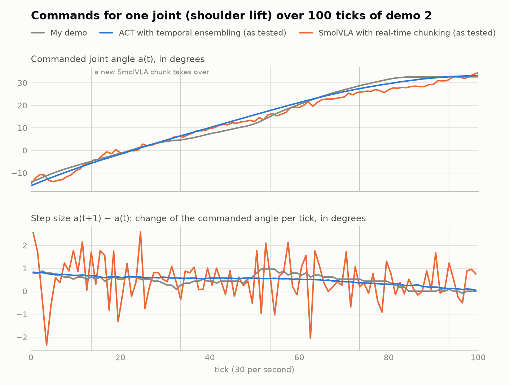

# Appendix

Details behind the [README](README.md): setup, data, models, every result table, and the full list of limitations.

- [Why this experiment](#why-this-experiment)
- [Setup](#setup)
- [Demonstrations](#demonstrations)
- [Models and training](#models-and-training)
- [Protocol](#protocol)
- [Results](#results)
- [Other findings](#other-findings)
- [Limitations](#limitations)
- [Reproduce](#reproduce)

## Why this experiment

Every robot-learning task in industry starts with the same questions: how many demonstrations does it need, and which model? Large pretrained models promise to need fewer demos, because they bring prior knowledge. SmolVLA was pretrained on community data from SO-100 arms, which are nearly the same body as the SO-101. In this project I am trying to find out if its pretraining pays off.

In an earlier simulation exercise on a different arm (ALOHA), SmolVLA's robot pretraining made no difference after
5,000 fine-tuning steps (20/50 against 19/50 with a randomly initialised action expert). This project tests the
matching-body case on real hardware.

## Setup

| | |
|---|---|
| Arm | SO-101 follower, teleoperated with an SO-101 leader arm |
| Cameras | 2 × Logitech C270, 640×480 at 30 fps (MJPG): one top-down, one from the side. No wrist camera |
| Object | a blue kitchen sponge; target: a white tray at a taped position |
| Scene | 9 taped dots 5 cm apart; the sponge starts on a dot, aligned or turned 45° |
| Light | indoor lamp light, curtains closed (the same light for demos and tests) |
| Computer | one PC for teleoperation, training and testing: NVIDIA RTX 3060 12 GB, Intel i5-6500 (4 cores), Ubuntu 22.04 |
| Software | [LeRobot](https://github.com/huggingface/lerobot) 0.6.0 |

<table>
<tr>
<td></td>
<td></td>
</tr>
<tr>
<td align="center">Start: sponge on a dot</td>
<td align="center">End: sponge in the tray</td>
</tr>
</table>


## Demonstrations

| | First recording ("rushed") | Second recording ("careful") |
|---|---|---|
| Demos recorded / used | 54 / 52 | 54 / 53 |
| Coverage | each dot 3× aligned, 3× at 45° | each dot 3× aligned, 3× at 45° |
| Length | 27 s at the start, 18 s by the end (I sped up) | 22 s on average to the release, steady |
| Grasp | quick | short wait above the sponge, then a careful grasp |
| Release | gripper opened about two thirds as wide as before the grasp | gripper opened fully |
| End of a demo | after driving back to the home pose | right after the release |
| Light | daylight, then dusk | the lamp |

Two demos of the first recording turned the wrist the other way at 45° and were left out. One demo of the second
recording closed the gripper again after the release and was left out.

In the first recording, 24 % of all frames come after the release, while the arm drives back home. 15 % of those
frames lie on the carry path to the tray, running the other way, so the same arm position is followed by opposite
moves. The second recording has no frames after the release.

## Models and training

| | ACT | SmolVLA |
|---|---|---|
| Start | from scratch | fine-tuned from `lerobot/smolvla_base` |
| Size | 52 M parameters | 450 M parameters, of which 100 M trained (the action expert; vision-language backbone frozen) |
| Training | 30,000 steps, batch 8 | 30,000 steps, batch 8 |
| Time on the RTX 3060 | about 2.5 h | about 3 h |
| One prediction on the RTX 3060 | about 20 ms, every step | about 325 ms per chunk of 50 steps (about 450 ms with real-time chunking) |
| Running on the robot | temporal ensembling: a new prediction every step, averaged | real-time chunking: chunks of 50 steps, the next one computed in the background |

Each model runs in its authors' real-robot setting. Without real-time chunking, SmolVLA stood still for about 5 of
every 30 seconds while it computed its next chunk (325 ms each).

## Protocol

The full protocol is in [protocol.md](protocol.md). It was committed before the first training run. Every later
addition is dated in the file and was committed before the trials it covers, except three coding rules that were
written after a test and before reviewing it; those are marked as such.

- **18 trials per model:** 9 dots × 2 angles (aligned, 45°), in a seeded order
  ([trial_order.csv](results/trial_order.csv)).
- **Interleaved:** blocks of 3 trials in an A B B A pattern, so slow drift (warm servos, light) hits both models
  equally.
- **One attempt per trial, 30 s limit.** Success means the whole sponge in the tray and released.
- **Failure codes,** the first thing that went wrong: `A` missed approach, `G` failed grasp, `D` dropped on the way,
  `M` missed the tray, `T` timeout, and `F` frozen on the way (holds the sponge but stops in mid-air; added after the
  test of ACT on the rushed recording).
- **Verdict rule:** a model's margin is √(n·p·(1−p)) trials; I believe a gap between the models only if it is at least
  2 × √(m_ACT² + m_SmolVLA²), about 6 of 18.
- **Bets** for each test were written in the protocol before it ran.

## Results

### Main test: 53 careful demos

| Model | Success | Margin | Grasp: clean / marginal / failed | Failures |
|---|---|---|---|---|
| ACT | 16/18 | ±1.3 | 13 / 3 / 2 | 2 × A |
| SmolVLA | 18/18 | ±0 by the formula* | 13 / 5 / 0 | none |

Gap 2; my margin rule needs a gap of at least 2.7. No significant difference: both models are at the ceiling of this
test (see [Is the difference significant?](#is-the-difference-significant)).

\* At 100 % the formula gives 0. The exact 95 % lower bound for 18 of 18 is about 81 %.

Grasp quality was scored from the video ([video_review.csv](results/video_review.csv)): *clean* means the gripper
closes around the sponge's sides on the first try; *marginal* means it held the sponge in the end, but came down on
top or at the edge, pushed or flipped it, or needed a second try. Both ACT failures had the same cause: the gripper
came down beside or on top of the sponge, and closing pushed it away.

### Follow-up: 18 demos

Does SmolVLA's pretraining help when demos are scarce? I retrained both models on 18 of the 53 careful demos (every
dot once aligned and once at 45°), with the same settings, and ran the same 36 trials.

| Model | 53 demos | 18 demos | Margin (18 demos) | Grasp (18 demos): clean / marginal / failed | Failures (18 demos) |
|---|---|---|---|---|---|
| ACT | 16/18 | 13/18 | ±1.9 | 10 / 5 / 3 | 3 × A, 1 × G, 1 × T |
| SmolVLA | 18/18 | 11/18 | ±2.1 | 8 / 3 / 7 | 5 × A, 2 × G |

- **ACT against SmolVLA with 18 demos:** gap 2; my margin rule needs a gap of at least 5.6. No significant difference.
- **Both did worse with fewer demos,** SmolVLA the most (18 → 11). This comparison runs across two days and wasn't part
  of the pre-registered verdict, so I report it as an observation.
- **A new failure:** the gripper standing in place above the sponge without closing or opening (SmolVLA twice, ACT
  once). It didn't happen in any counted trial with 53 demos.
- **Noticed afterwards (not pre-registered):** all 5 ACT failures were on aligned placements (4/9 aligned, 9/9 at 45°).

### Is the difference significant?

I checked it two ways and both say there is no significant difference.

#### Margin rule

| Test | ACT | SmolVLA | Gap | Gap my rule needs |
|---|---|---|---|---|
| Main test, 53 demos | 16/18 | 18/18 | 2 | 2.7 |
| 18 demos | 13/18 | 11/18 | 2 | 5.6 |

#### Paired placement comparison

| Test | Both succeed | Only ACT | Only SmolVLA | Both fail | Exact McNemar test |
|---|---|---|---|---|---|
| Main test, 53 demos | 16 | 0 | 2 | 0 | p = 0.50 |
| 18 demos | 9 | 4 | 2 | 3 | p = 0.69 |

<details>
<summary><b>Show statistical details & formulas</b></summary>
<br>

**My margin rule** (fixed before testing). A model's margin is $m = \sqrt{n\,p\,(1-p)}$ trials, where $n$ is the number of trials and $p$ is the success rate. A gap between models is only treated as meaningful if it is at least: $2\sqrt{m_\text{ACT}^2 + m_\text{SmolVLA}^2}$.

**The exact McNemar test** (added 13 November 2026, after the tests). Both models got the same 18 placements, so I compare them placement by placement. Only the placements where exactly one model succeeded and the other failed count: $b$ for ACT and $c$ for SmolVLA. If the models were equally good,  each disagreement behaves like a fair coin flip. The p-value is the probability that $b + c$ fair coin flips split at least this unevenly ($p = 1$ if the formula gives more than 1):

$$p = 2 \sum_{i=0}^{\min(b,c)} \binom{b+c}{i} \left(\tfrac{1}{2}\right)^{b+c}$$

* **Main test, 53 demos ($b = 0, c = 2$):** 
  $$p = 2 \binom{2}{0} \left(\frac{1}{2}\right)^2 = 2 \cdot \frac{1}{4} = 0.50$$
* **18 demos ($b = 4, c = 2$):** 
  $$p = 2 \left[ \binom{6}{0} + \binom{6}{1} + \binom{6}{2} \right] \left(\frac{1}{2}\right)^6 = 2 \cdot \frac{1 + 6 + 15}{64} = 0.69$$

A difference counts as significant when $p < 0.05$. An earlier version used Fisher's exact test (0.49 and 0.72), which ignores that the trials are paired. The test ([McNemar, 1947](https://doi.org/10.1007/BF02295996)) is used for comparing two models that were each trained once and tested on the same cases. 

Codes and grasp quality for the 18-demo test come from my notes during the trials ([demos18_video_review.csv](results/demos18_video_review.csv)).
</details>


#### What this means

- **No significant difference.** Neither check separates ACT and SmolVLA.
- **That does not prove they are equally good.** With 18 placements this experiment can only see a large difference: the smallest split the paired test calls significant is 6 placements to 0.
- **The main test left little room for a gap.** Both models were close to 100 %.
- **What would show a smaller difference:** more trials, or a task where the models can differ more. Part 2 of this project does the second: two sponges, two trays and four sentences, with 36 trials per system, 12 of them on placements kept out of the demos.


### Setup control

The cameras had shifted a few pixels and the GPU driver had been updated since the main test. So before the 18-demo
trials I ran the two 53-demo models again on the first 18 trials of the order
([control53_trials.csv](results/control53_trials.csv)): 8/9 each, against 9/9 each in the main test. On the same
trials the 18-demo models scored 6/9 each. So the setup change alone doesn't explain the drop.

### Extra tests (reported separately from the 18)

| Test | ACT | SmolVLA | For comparison |
|---|---|---|---|
| Yellow sponge, same 4 corner placements, sentence unchanged | 0/4 | 0/4 | blue sponge on the same placements: 4/4 and 4/4 |
| Yellow sponge, sentence says "yellow" (decided after the 0/8) | not run | 0/4 | |
| Trained on the rushed first recording | 0/18 | 7/18 | careful recording: 16/18 and 18/18 |

- With the yellow sponge, ACT came close and just missed it; SmolVLA did not even come close. With "yellow" in the
  sentence, SmolVLA often didn't go down to the sponge at all. ACT has no language input, so the sentence test was
  SmolVLA only.
- During fine-tuning, SmolVLA's vision-language backbone was frozen; only the action expert was trained, and it only
  ever saw one blue sponge and one sentence. The backbone still "knows" yellow, but the part that turns what it sees
  into movement never learned to use it.
- Yellow also stands out less against the light table than blue, so contrast may play a part.
- On the rushed recording the two models failed in different ways. SmolVLA failed at the approach (4 × A) and the
  grasp (6 × G), exactly the manoeuvres I rushed, and missed the tray once (1 × M). ACT held the sponge in 11 of 18
  trials, then froze in mid-air and never reached the tray (10 × F; 8 × A). Most likely cause: the way home in those
  demos passes the same arm positions as the way to the tray, in the opposite direction (see
  [Demonstrations](#demonstrations)). Why SmolVLA didn't freeze I haven't tested.
- The two rushed-recording tests ran on different days (SmolVLA on 10 November, ACT on 11 November), not
  interleaved, so I don't compare the two models there. Before this, ACT on the rushed recording only had 12
  uncounted pilot tries (3 of 12).

<details>
<summary><b>All counted outcomes</b></summary>
<br>

| Test | Model | S | A | G | D | M | T | F |
|---|---|---|---|---|---|---|---|---|
| Main, 53 demos | ACT | 16 | 2 | | | | | |
| Main, 53 demos | SmolVLA | 18 | | | | | | |
| 18 demos | ACT | 13 | 3 | 1 | | | 1 | |
| 18 demos | SmolVLA | 11 | 5 | 2 | | | | |
| Rushed recording | ACT | 0 | 8 | | | | | 10 |
| Rushed recording | SmolVLA | 7 | 4 | 6 | | 1 | | |
| Yellow sponge | ACT | 0 | 2 | 1 | 1 | | | |
| Yellow sponge | SmolVLA | 0 | 3 | 1 | | | | |
| Yellow sponge, "yellow" sentence | SmolVLA | 0 | 4 | | | | | |

The main test, the 18-demo test and ACT on the rushed recording use the codes after the coding rule
([video_review.csv](results/video_review.csv), [demos18_video_review.csv](results/demos18_video_review.csv),
[act_v1_video_review.csv](results/act_v1_video_review.csv)); the other rows are the codes as typed during the test.
</details>

### My bets against the results

| Test | Bet | Result |
|---|---|---|
| ACT, main test | 9/18 | 16/18 |
| SmolVLA, main test | 10/18 | 18/18 |
| ACT, yellow sponge | 1/4 | 0/4 |
| SmolVLA, yellow sponge | 4/4 | 0/4 |
| SmolVLA, "yellow" sentence | 4/4 | 0/4 |
| SmolVLA, rushed recording | 5/18 | 7/18 |
| ACT, rushed recording | 5/18 | 0/18 |
| ACT, 18 demos | 10/18 | 13/18 |
| SmolVLA, 18 demos | 15/18 | 11/18 |

I underestimated both models on careful data, and overestimated SmolVLA's ability to generalise and ACT on the rushed
data.

## Other findings

- **Small hardware details matter.** The C270 webcams only gave 15 fps in dim light until I switched off one camera setting (`exposure_dynamic_framerate`). Both cameras moved 3-4 pixels between test days. A setup control showed no clear effect: both models scored 8/9, against 9/9 in the main test.
- **Fixing the rule before the data keeps me honest.** My bets were far off, and a 2-trial gap is a tie by my own rule.
  Writing that rule down first is what stops me from calling 18 against 16 a win.
- **SmolVLA moved more shakily than ACT.** Measured offline as how much the commanded step changes from tick to tick, with my demos as 1×: SmolVLA’s commands were about 14× rougher. ACT’s raw predictions were about 6×, but temporal ensembling averages that away (0.3×, smoother than my demos); LeRobot has no such averaging for SmolVLA. A smaller part: real-time chunking ties the first 10 steps of a new chunk to the old one (the default setting), but my GPU needs 14 steps to compute a chunk. By then those 10 steps are already in the past, so the arm jumps at each switch. Offline, a setting of 20 (`execution_horizon`) removed the jump; I haven’t tried it on the robot.

## SmolVLA's motion

On the robot, SmolVLA moved more shakily than ACT. I observed this visually, so I checked it offline.

**Method.** From the careful recording I took 6 demos (episodes 2, 15, 24, 30, 38 and 50). Each model got the recorded camera frames of 200 ticks per demo, and the commands were analyzed. A smooth arm moves in steps of about the same size; a shaky arm keeps changing its step size. This change in step size (here called roughness) is the mean absolute second difference of the commands, |a(t+1) − 2·a(t) + a(t−1)|, averaged over the 6 joints, the ticks and the 6 demos.

| Commands | Roughness | Against my demos |
|---|---|---|
| My demos | 0.062 | 1× |
| ACT, raw predictions | 0.369 | 6× |
| ACT with temporal ensembling (as tested) | 0.017 | 0.3× |
| SmolVLA with real-time chunking (as tested) | 0.887 | 14× |

Temporal ensembling averages ACT's roughness away. LeRobot has no such averaging for SmolVLA. See figure below: SmolVLA’s step size jumps up and down from tick to tick, while ACT with temporal ensembling is steadier because it averages its predictions.



**The joins between chunks.** SmolVLA needs about 14 ticks to compute a chunk of 50 actions. The arm keeps
following the old chunk meanwhile, so the first 14 actions of the new chunk are too late. Real-time chunking
ties the first 10 actions of the new chunk to the old one (the default `execution_horizon`):

```
action of the new chunk:   1 .............. 10 | 11 .... 14 | 15 ............ 50
tied to the old chunk:     yes                 | no         | no
when the chunk is ready:   actions are too late and dropped | executed (jump at action 15)
```

The arm takes over at action 15, which is not tied, so it jumps: offline 1.62 per joint at a join, against 0.5–0.6 for a normal step. With a setting of 20 the jump was 0.50. This is the smaller part: the roughness then goes from 14× to 12×.

**What this rests on.**
- Seen on the robot: SmolVLA shook more than ACT. By eye, not measured.
- Measured offline: the roughness and the jumps. The models' commands were not fed back to an arm, and
  commands are not the arm's real motion.
- Read from LeRobot's code (0.6.0): how the tie and the delay work together.
- Not tested on the robot: a longer `execution_horizon`.

## Limitations

- **Small samples.** 18 trials per model can only show gaps of about 6 or more.
- **Not blind.** I placed the sponge, judged every trial, and knew which model was running.
- **Rushed against careful demos:** the light changed too (daylight against the lamp), so this comparison can't fully
  separate demo quality from light. The two tests on the rushed recording also ran on different days (SmolVLA on 10
  November, ACT on 11 November), not interleaved with each other or with the careful-demo tests.
- **Cameras:** the side camera sat a few pixels off its demo position during all tests. Both cameras had moved a few
  pixels more by the 18-demo test, and the top camera moved about 5 pixels during it. The setup control checks the
  effect on the 53-demo models; the two models within each test were always interleaved.
- **Compute:** with temporal ensembling, ACT's control loop ran at 9–30 Hz on the 4-core CPU, below the 30 Hz of the
  demos. The GPU driver was updated between the main test and the 18-demo test; the measured inference times didn't
  change. The 12 GB GPU also limits which models I can fine-tune; I didn’t try larger VLAs.
- **Training budget:** both models got the same training budget, 30,000 steps at batch size 8. This was fixed before training so that each run fits in one evening on this GPU (LeRobot’s default is 100,000 steps). That is 30,000 × 8 = 240,000 frames shown. The 53 demos hold 40,781 frames, so each model saw every frame about 240,000 / 40,781 ≈ 6 times. I only tested the final checkpoint and didn’t tune the number of steps. The 18-demo models used the same 30,000 steps, so they saw each demo about 3× as often; I did not tune anything for the smaller set.
- **Rules added after a test:** the rule for which code to use when one problem leads to another, and the grasp-quality
  scale, were written after the main test but before watching its video. The codes for "never closes" (G) and "frozen
  on the way" (F) were added after the tests where they first appeared, before reviewing them. The yellow-sentence
  test was decided after the yellow results. All are marked as such in the protocol.
- **Pilot tries:** 16 uncounted tries before the main test fixed the inference settings (listed in the protocol).
- **No image augmentation** during training, so absolute pixel positions were a reliable cue for both models.
- **One object, one tray position, one light.** Nothing here says how the models generalise beyond that.

## Reproduce

- Every command I ran, in order, is in [commands.md](commands.md): camera settings, recording, training, the test
  rollouts and the analysis.
- [scripts/make_trial_order.py](scripts/make_trial_order.py) makes the seeded trial order,
  [scripts/eval_log.py](scripts/eval_log.py) records each trial's outcome, and
  [scripts/analyze.py](scripts/analyze.py) computes success rates, margins and the verdict:

  ```bash
  python scripts/analyze.py results/trials.csv
  ```