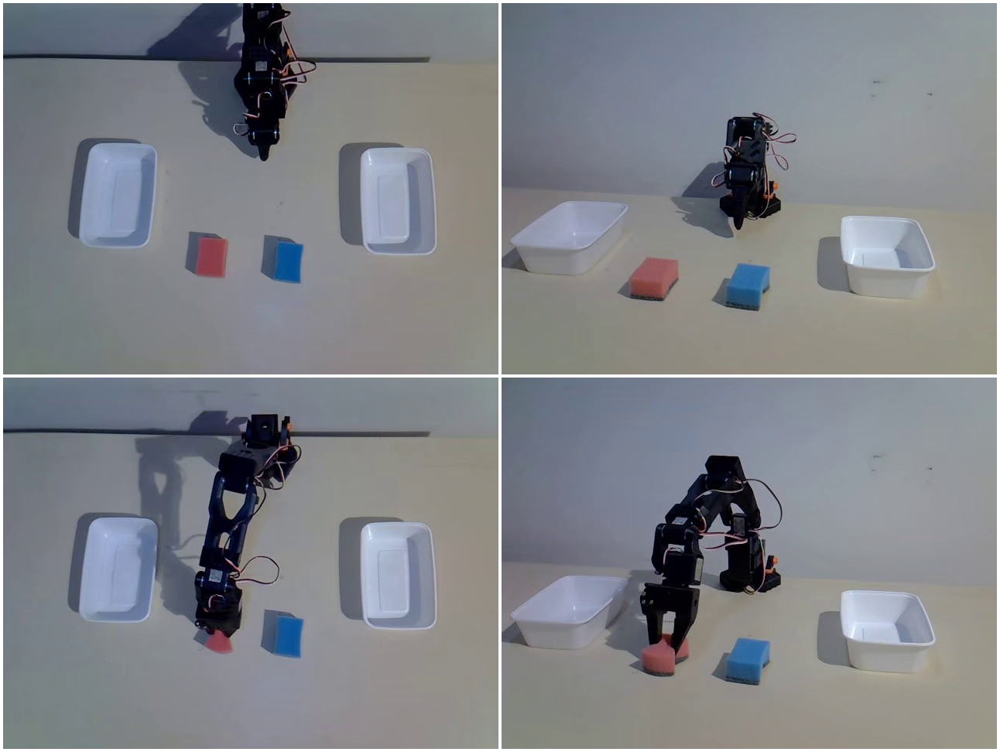

# Appendix, part 2

Details behind part 2 of the [README](README.md#part-2-does-the-arm-do-what-the-sentence-says): setup, data,
models, every result table, the corrections and the full list of limitations. Part 1 is in
[APPENDIX.md](APPENDIX.md).

- [Setup](#setup)
- [Demonstrations](#demonstrations)
- [Models and training](#models-and-training)
- [Protocol](#protocol)
- [Results](#results)
- [Corrections and repeated runs](#corrections-and-repeated-runs)
- [Cameras and light](#cameras-and-light)
- [Limitations](#limitations)
- [Reproduce](#reproduce)

## Setup

The arm, the two cameras, the computer and the light are the same as in part 1 ([APPENDIX.md](APPENDIX.md#setup)).
What is new:

| | |
|---|---|
| Objects | a blue and a red kitchen sponge, always both on the table |
| Targets | two white trays, left and right of the arm, on tape marks |
| Scene | six dots in front of the arm: L1–L3 and R1–R3, columns 12 cm apart, rows 6 cm apart. One sponge on a left dot, one on a right dot, aligned |
| Sentences | 1. "Put the blue sponge in the left tray." 2. "Put the blue sponge in the right tray." 3. "Put the red sponge in the left tray." 4. "Put the red sponge in the right tray." |
| Placements | 18 (9 dot pairs, both colour orders). 12 are in the demos, 6 are kept out: dot pairs L1-R2, L2-R1 and L3-R3 |
| Software | LeRobot 0.6.0, as in part 1 |



## Demonstrations

| | |
|---|---|
| Recorded / used | 111 / 96, all on 13 November 2026 |
| Per sentence | 24 demos: each of the 12 demo placements twice |
| Rounds | 8 rounds of 12 demos; one round is one sentence on the 12 demo placements |
| End of a demo | when the gripper is fully open; going home is not recorded |
| Pace | in rounds 2 to 8 I let go of the sponge after 17 to 19 s on average |

- Round 1 was recorded again at the end of the session, because I was slower there than in the other rounds (23 s
  to letting go). The first round 1 is not used.
- Three single demos were recorded again and their first versions are left out: twice the sponges were on swapped
  sides, once the arm stood still for about 10 s.
- 8 practice demos on 12 November are not used.

## Models and training

| Model | Demos | Start | Steps, batch | Time on the RTX 3060 |
|---|---|---|---|---|
| SmolVLA | all 96 | fine-tuned from `lerobot/smolvla_base`, backbone frozen | 46,000, batch 8 | 5 h 04 min |
| ACT, one model per sentence (4 models) | the 24 of its sentence | from scratch | 46,000, batch 8 | 3 h 47 to 3 h 52 min each |
| SmolVLA on 48 demos | 48 of the 96 | as SmolVLA | 46,000, batch 8 | 4 h 43 min |
| SmolVLA on 24 demos | 24 of the 48 | as SmolVLA | 46,000, batch 8 | 4 h 43 min |

- 46,000 steps is 6 passes over the 96 demos (61,358 frames) at batch 8. It was fixed after the recording and
  before training.
- Running on the robot: ACT with temporal ensembling (`n_action_steps=1`, `temporal_ensemble_coeff=0.01`), as in
  part 1. SmolVLA with real-time chunking and `execution_horizon=15`; part 1 ran the default, 10. The reason is in
  [protocol_part2.md](protocol_part2.md).
- The four ACT models are one system: I pick the model that belongs to the sentence. ACT itself has no sentence
  to read.

## Protocol

The full protocol is in [protocol_part2.md](protocol_part2.md). The protocol and my bets were committed before any
demo was recorded. Every later addition is dated in the file.

- **Main test, 36 trials per system:** 9 per sentence, 6 on demo placements and 3 on kept-out ones, in a seeded
  order ([part2_trial_order.csv](results/part2_trial_order.csv)). Both systems get the same 36 trials.
- **Interleaved:** blocks of 3 trials, and the system that goes first alternates.
- **One attempt per trial, 30 s limit.** Success means the named sponge fully inside the named tray and released.
- **What I note per trial:** which sponge it went for (named, other, none), which tray it went to (named, other,
  none), and the outcome code. The codes are those of part 1, plus `W` wrong sponge and `X` wrong tray. The code is
  the first thing that went wrong.
- **Verdict rules:** between the systems my margin rule from part 1 (worked out beforehand as a gap of about 9 of
  36). Against luck: a system that ignores the sentence gets about 9 of 36, and 16 or more rules luck out; for the
  reworded sentences 9 or more of 16. Fewer demos: 24 against 96 demos, a gap of about 7 of 24.
- **Reworded sentences, 16 trials, SmolVLA only**
  ([part2_reworded_order.csv](results/part2_reworded_order.csv)), in the same session as the main test.
- **Fewer demos, 60 trials** ([part2_fewer_demos_order.csv](results/part2_fewer_demos_order.csv)): the 24-demo and
  the 48-demo model each on the 24 demo-placement trials of the main test, and the 96-demo model again on 12 of
  them, interleaved on one day.

## Results

### Main test

| System | Named sponge in the named tray | Went for the named sponge | Went to the named tray | Demo placements | New placements | Failures |
|---|---|---|---|---|---|---|
| SmolVLA | 34/36 | 36/36 | 34/36 | 23/24 | 11/12 | 2 × A |
| 4 × ACT | 36/36 | 36/36 | 36/36 | 24/24 | 12/12 | none |

| Sentence | SmolVLA | 4 × ACT |
|---|---|---|
| 1. blue sponge, left tray | 9/9 | 9/9 |
| 2. blue sponge, right tray | 8/9 | 9/9 |
| 3. red sponge, left tray | 9/9 | 9/9 |
| 4. red sponge, right tray | 8/9 | 9/9 |

- Gap 2. My margin rule needs a gap of at least 2.7, so I found no difference between the systems. Both are far
  above the 16 that rules out luck.
- SmolVLA's two failures (trials 5 and 55) were the same: it went for the named sponge, the gripper was not
  aligned, and it did not pick the sponge up. In those two trials it never reached a tray, which is why "went to
  the named tray" reads 34/36.
- The new placements are new pairs of dots. Each sponge still lay on a dot it had been on in the demos.
- On the robot SmolVLA again moved more shakily than ACT. I saw this and did not measure it again
  (part 1: [SmolVLA's motion](APPENDIX.md#smolvlas-motion)).

### Reworded sentences

The reworded sentences follow one pattern: *"Place the blue sponge into the tray on the left."* instead of
*"Put the blue sponge in the left tray."* SmolVLA never saw them in training.

| Sentence | Trained wording (main test) | Reworded |
|---|---|---|
| 1. blue sponge, left tray | 9/9 | 4/4 |
| 2. blue sponge, right tray | 8/9 | 3/4 |
| 3. red sponge, left tray | 9/9 | 1/4 |
| 4. red sponge, right tray | 8/9 | 3/4 |
| All | 34/36 | 11/16 |

- 11/16 is above the 9 that rules out luck. It went for the named sponge in 14/16 trials and to the named tray in
  14/16.
- The five failures: twice the wrong sponge, both on reworded sentence 3 (trials 5 and 6: it went for the blue
  sponge), one missed grasp (trial 3), one gripper that stood above the sponge and never closed (trial 14), and one
  failed grasp of the named sponge, also on sentence 3 (trial 15: after it the arm took the blue sponge to the left
  tray).
- Lower than with the trained wording, but not certain: the gap is right at the line of my margin rule, and I had
  set no rule for this comparison before the test. I report it as an observation.
- Whether reworded sentence 3 is harder than the others I can't say with 4 trials per sentence.

### Fewer demos

| SmolVLA trained on | Placements in its demos | Same 24 trials | Went for the named sponge | Failures |
|---|---|---|---|---|
| 96 demos | 12, two demos per sentence and placement | 23/24 (main test, 15 November) | 24/24 | 1 × A |
| 48 demos | 12, one demo per sentence and placement | 23/24 | 24/24 | 1 × A |
| 24 demos | 6, one demo per sentence and placement | 14/24 | 22/24 | 7 × A, 2 × G, 1 × W |

- **24 against 96 demos:** gap 9, above my line of about 7. **48 against 96 demos:** no gap.
- **Check of the setup:** the 96-demo model repeated 12 of the 24 trials on 16 November, interleaved with the other
  two models: 12/12, against 11/12 on the same trials the day before. My stop rule (4 or more below) did not
  trigger.

**Split by placement (made after the test, not pre-registered).** The 24-demo set holds only 6 of the 12 demo
placements (dot pairs L1-R1, L2-R3 and L3-R2). The same 24 trials, split along that line:

| SmolVLA trained on | On the 6 placements of the 24-demo set | On the other 6 placements |
|---|---|---|
| 24 demos | 11/12 | 3/12 |
| 48 demos | 12/12 | 11/12 |
| 96 demos (main test) | 11/12 | 12/12 |

- The 24-demo model worked on the placements it had demos of and failed on the ones it had none of (9 failures:
  6 × A, 2 × G, 1 × W). The other two models show that those six placements are not harder in themselves.
- With one demo per sentence and placement the 48-demo model scored as well as the 96-demo model with two.
- The 96-demo model did handle pairs outside its own demos (11/12 in the main test). A likely reason, which I did
  not test: in the 96 and 48 demos every position of one sponge comes with two positions of the other, in the 24
  demos with only one, so the model can learn the two sponges as one picture.

### All counted outcomes

| Test | System | S | A | G | W | X |
|---|---|---|---|---|---|---|
| Main | 4 × ACT | 36 | | | | |
| Main | SmolVLA | 34 | 2 | | | |
| Reworded | SmolVLA | 11 | 1 | 2 | 2 | |
| Fewer demos | SmolVLA, 24 demos | 14 | 7 | 2 | 1 | |
| Fewer demos | SmolVLA, 48 demos | 23 | 1 | | | |
| Fewer demos | SmolVLA, 96 demos (12 repeats) | 12 | | | | |

148 counted trials, 18 failures: 15 at the grasp (11 × A, 4 × G) and 3 times the wrong sponge. The codes D, M, T
and F did not occur.

**Which word is harder, the colour or the side?** (the extra question in my protocol) In the main test neither:
there was no word mistake at all. Over all 148 trials the arm went for the wrong sponge 3 times and never to the
wrong tray. Two of the three were on one reworded sentence, so this is too little to say more.

### Failure analysis

After the test I went through the 18 failed trials with two questions: what kind of failure was it, and was the
placement in the demos of the model that ran it?

**Kind of failure.** 15 of the 18 were grasp failures (execution failures): the arm did not pick the sponge up.
In 14 of them it went for the named sponge, in one (fewer-demos trial 47) it came down between the two sponges.
The other 3 were instruction-following failures: the arm went for the wrong sponge.

**Placement.**

| Failed trials | SmolVLA trained on | Kind of failure | Placement in its demos |
|---|---|---|---|
| Main test 5 | 96 demos | grasp | yes |
| Main test 55 | 96 demos | grasp | no, kept out |
| Reworded 3, 14, 15 | 96 demos | grasp | yes |
| Reworded 5, 6 | 96 demos | wrong sponge | yes |
| Fewer demos 11 | 48 demos | grasp | yes |
| Fewer demos 1 | 24 demos | grasp | yes |
| Fewer demos 3, 28, 31, 32, 33, 43, 46, 47 | 24 demos | grasp | no |
| Fewer demos 58 | 24 demos | wrong sponge | no |

- **24-demo model: missing placements explain most of its failures.** 9 of its 10 failures were on placements
  outside its demos. In each of them the named sponge lay on a dot where it was picked up in a demo. Only the
  other sponge lay somewhere new.
- **96-demo model: missing placements do not explain its failures.** 6 of its 7 failures were on placements it
  had two demos of per sentence. 5 of the 7 were grasp failures and 2 the wrong sponge.
- **The colour order does not explain them either.** Whenever a placement was in the demos, the same two dots
  with the colours swapped were in them too, for every sentence. No model saw only one colour order.
- **Wrong sponge with a reworded sentence (trials 5 and 6).** The same model did the placement of trial 6 twice
  with the trained sentence and succeeded both times (main test trial 41, fewer-demos trial 39). So the
  placement was not the problem. What differed was the wording, and that the reworded trials ran last that
  evening. Both times the arm went to the left tray, the named one: it followed "left" but not "red". On the
  video it went straight to the blue sponge in trial 6. In trial 5 it hesitated between the two sponges first.
- **Grasp failures with a reworded sentence (trials 14 and 15).** With the trained sentence the same model
  succeeded twice on each of these placements. The new wording may also make the grasp less sure, but with so
  few trials that is a guess.

All of this follows from [part2_demo_order.csv](results/part2_demo_order.csv) (the columns `in_48` and `in_24`
say which demos the smaller sets hold) and the three trial files.

### Is the difference significant?

| Comparison | Numbers | My rule | Exact test | Planned before the test |
|---|---|---|---|---|
| SmolVLA against 4 × ACT, main test | 34/36 against 36/36 | gap 2, needs 2.7: no difference | McNemar p = 0.50 | yes |
| 24 against 96 demos | 14/24 against 23/24 | gap 9, line about 7: a difference | McNemar p = 0.012 | yes |
| 48 against 96 demos | 23/24 against 23/24 | no gap | McNemar p = 1.0 | no rule set |
| Reworded against trained wording | 11/16 against 34/36 | gap 26 points, line 24 points: at the line | Fisher p = 0.023 | no |
| 24-demo model, own placements against the others | 11/12 against 3/12 | | Fisher p = 0.003 | no, made after the test |

- The margin rule and the exact McNemar test are explained in
  [APPENDIX.md](APPENDIX.md#is-the-difference-significant). McNemar compares two models trial by trial on the same
  trials. Where the trials are not the same I use Fisher's exact test.
- The numbers behind the McNemar tests. Main test: 34 trials where both succeed, 2 where only ACT succeeds. 24
  against 96 demos: 13 both, 10 only the 96-demo model, 1 only the 24-demo model. 48 against 96 demos: 22 both, 1
  and 1.
- Against luck: 16 or more of 36 by guessing has a chance of about 0.9 %, and 11 or more of 16 about 0.03 %.
- The two comparisons that were not planned are observations, not verdicts.

### My bets against the results

| Test | Bet | Result |
|---|---|---|
| SmolVLA, main test | 30/36 | 34/36 |
| 4 × ACT, main test | 9/36 | 36/36 |
| SmolVLA, reworded sentences | 8/16 | 11/16 |
| SmolVLA on 24 demos | 6/24 | 14/24 |
| SmolVLA on 48 demos | 12/24 | 23/24 |

I underestimated every system. The ACT bet was far off: I bet as if ACT had to guess the sentence, but each
sentence has its own ACT model and I pick the model.

## Corrections and repeated runs

**Rows corrected after the tests.** Each result file was committed as typed first; the corrections are commits of
their own.

| File | Trial | Typed (sponge / tray / code) | Now | Why |
|---|---|---|---|---|
| Reworded | 5 | O / Y / X | O / Y / W | it went for the other sponge first, so the code is W |
| Reworded | 6 | O / Y / X | O / Y / W | the same |
| Reworded | 15 | O / Y / S | Y / Y / G | first changed to O / Y / W from my note; the video shows it went for the named sponge first and the grasp failed, then it took the other sponge to the named tray |
| Reworded | 7 | Y / N / S | Y / Y / S | first changed to Y / O / X from my note; the video shows the red sponge in the left tray, the named one |
| Fewer demos | 28 | Y / Y / S | Y / Y / A | it went to the tray without the sponge |
| Fewer demos | 33 | Y / N / A | Y / Y / A | it went on to the named tray without the sponge |
| Fewer demos | 47 | N / N / A | N / Y / A | the same |

- Reworded: commits `8e5e44d` (as typed), `970b36f` (from my notes), `0fde946` (trial 7, from the video) and
  `45ad852` (trial 15, from the video). By the success rule the typed file gives 10/16; it is 11/16 now.
- Fewer demos: commits `220b364` (as typed) and `175c9bf` (from my notes). The 24-demo model has 15/24 in the typed
  file and 14/24 now.

**Check against the video.** Every trial was filmed with a phone. After the tests the end of each of the 148
trials was checked against the film: 147 rows agreed, and reworded trial 7 did not (corrected above). Reworded
trial 15 was corrected later: its end agreed with the row, but in the clip for the project video I saw that the arm
first went for the named sponge and the grasp failed. Unlike in part 1, I did not score grasp quality from the video.

**Runs that have no row.** The film and the model starts on the PC show three runs more than there are rows.

- Fewer demos, trials 56 and 57: I had placed the sponges on swapped sides, noticed it after both trials and ran
  both again as listed. All four runs succeeded. The rows were typed after the first runs.
- Main test, trial 29: it ran twice. On the film the sponges lie on swapped sides in the first run and as listed in
  the second. Both runs succeeded. I did not note this during the test.
- Main test, trial 61: one start was stopped before the arm moved. On the film the sponges lie on swapped sides
  and are then put right.

No score depends on these runs.

## Cameras and light

- **Light:** the same lamp light, curtains closed, on both test days.
- **Top camera:** did not move.
- **Side camera:** its picture sat 2.6 to 3.0 px higher than during the recording on both test days (2.3 px on 14
  November, as written in the protocol), and it moved about 1.2 px sideways during the evening of 15 November. I
  left it there.
- **What that does, checked offline on recorded pictures:** with the side picture moved by these amounts, ACT plans
  its gripper close a few frames later (0.1 to 0.2 s). SmolVLA changes less than between two of its own noise draws.
  These are plans on pictures, not grasps.

## Limitations

- **Small samples.** 36 trials per system can only show gaps of about 9; the 16 and 24 trials of the other tests
  even less.
- **Not blind.** I placed the sponges, judged every trial, and knew which model was running.
- **At the ceiling.** Both systems are close to 100 % in the main test, so it cannot show which one is better.
- **"New" is only new pairs.** Every single position was in the demos, with the same two sponges, trays, table and
  light. Part 1 showed that a new sponge colour fails.
- **Reworded sentences:** one rewording per sentence, 4 trials each, and all of them ran last that evening, so
  wording and time can't be told apart.
- **Fewer demos:** the 24-demo set differs from the 48-demo set in two ways at once, half the demos and half the
  placements. The split by placement was made after the test. The 96-demo number comes from the day before; the 12
  repeats check that the setup had not changed.
- **One training run per model.** A second run of the same model could score differently.
- **Training budget:** every model got 46,000 steps at batch 8. That is 6 passes over the 96 demos, about 12 over
  the 48 and about 25 over the 24; each ACT model saw its 24 demos about 24 times. I only tested the last
  checkpoint and didn't tune the number of steps.
- **The ACT system includes me.** I read the sentence and pick the model. This test does not say what it costs to
  train and keep one model per sentence when there are many sentences.
- **Corrections and repeated runs:** seven rows were corrected after the tests and three trials ran twice (see
  [Corrections and repeated runs](#corrections-and-repeated-runs)).
- **Cameras:** the side camera sat a few pixels off its demo position during all tests (see
  [Cameras and light](#cameras-and-light)).
- **Pilot tries:** 12 uncounted tries on 14 November (4 ACT, 8 SmolVLA) fixed SmolVLA's `execution_horizon`
  (listed in the protocol).
- **Grasp:** most failures were at the grasp. Depth is hard to see in the side camera's picture, and a wrist camera
  might help. I did not test that.
- **No image augmentation** during training, as in part 1.

## Reproduce

- Every command I ran, in order, is in [commands_part2.md](commands_part2.md): the lists, recording, merging,
  training, the test rollouts and the analysis.
- [scripts/make_part2_lists.py](scripts/make_part2_lists.py) makes the seeded lists,
  [scripts/eval_log_part2.py](scripts/eval_log_part2.py) records each trial, and
  [scripts/analyze_part2.py](scripts/analyze_part2.py) prints the numbers of the tables:

  ```bash
  python scripts/analyze_part2.py results/part2_trials.csv
  python scripts/analyze_part2.py results/part2_reworded_trials.csv
  python scripts/analyze_part2.py results/part2_fewer_demos_trials.csv
  ```
