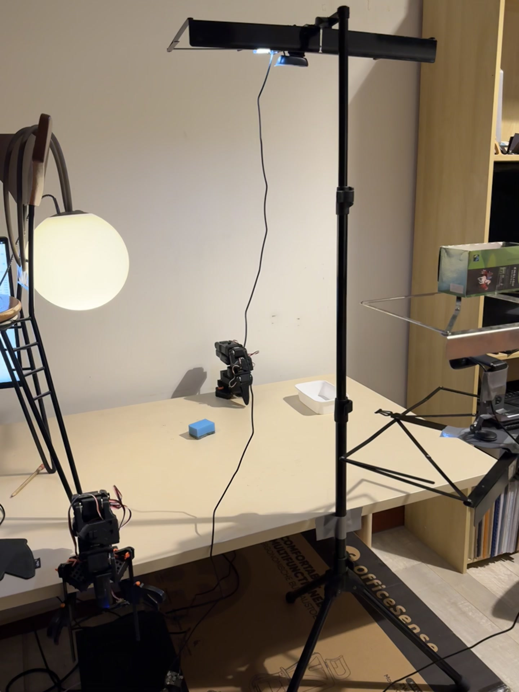
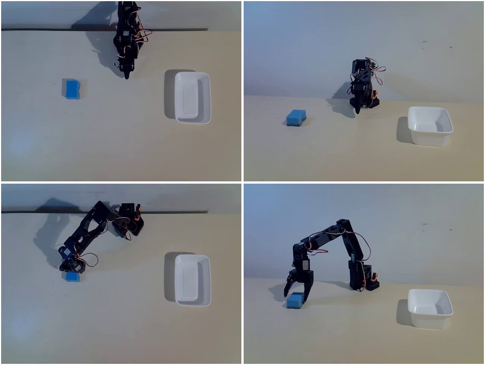

# ACT vs SmolVLA on a real SO-101

In this experiment I compare a specialist model (ACT, trained from scratch) against a robot-pretrained
vision-language-action model (SmolVLA, fine-tuned from `lerobot/smolvla_base`) on a pick-and-place task. I do this on
a low-cost SO-101 arm and train on my own machine.

Task: *"Pick up the blue sponge and put it in the white tray."*

<!-- VIDEO: the 60 s video goes here. -->

## Results

| Test | ACT | SmolVLA |
|---|---|---|
| 53 careful demos (main test) | 16/18 | 18/18 |
| 18 of those demos | 13/18 | 11/18 |
| Yellow sponge instead of blue | 0/4 | 0/4 |
| 52 rushed demos (my first recording) | not run | 7/18 |

Each model got the same 18 placements of the sponge, interleaved with the other model. By the rule I fixed before
testing, neither the main test nor the 18-demo test shows a believable difference between ACT and SmolVLA.

## What I found

1. **How I recorded the demos mattered more than the model.** My first recording was rushed: I sped up, grasped
   quickly and barely opened the gripper over the tray. I recorded everything again, slower and more carefully.
   SmolVLA went from 7/18 to 18/18 (the light also changed between the two recordings).
2. **Fewer demos hurt the grasp first.** With 18 instead of 53 demos, SmolVLA failed to hold the sponge in 7 trials
   instead of 0. Both models sometimes stood above the sponge without closing the gripper.
3. **The models learned this blue sponge, not "a sponge".** A yellow sponge failed on placements where the blue one
   worked 8 of 8. Writing "yellow" in SmolVLA's task sentence didn't help (0/4).
4. **A high success rate hid sloppy grasps.** Only 13 of 18 grasps were clean for each model in the main test; the
   soft sponge forgave the rest.

The details, every table and the full list of limitations are in [APPENDIX.md](APPENDIX.md).

## Setup

- SO-101 follower arm, teleoperated with an SO-101 leader arm.
- Two Logitech C270 webcams (top and side), no wrist camera.
- 9 taped dots 5 cm apart; the sponge starts on a dot, aligned or turned 45°. Lamp light, curtains closed.
- ACT from scratch; SmolVLA fine-tuned from `lerobot/smolvla_base`. Both 30,000 steps on one RTX 3060 (12 GB),
  with [LeRobot](https://github.com/huggingface/lerobot) 0.6.0.

## How I tested

- The protocol ([protocol.md](protocol.md)) was committed before the first training run, with a bet before each test.
- 9 dots × 2 angles = 18 trials per model, in a seeded order, in blocks of 3 alternating between the models.
- One attempt per trial, 30 seconds. Success means the whole sponge in the tray and released.
- I only believe a gap between the models if it is at least twice its margin, about 6 of 18 here.

## Limitations

- 18 trials per model can only show large gaps.
- I judged every trial myself and knew which model was running.
- The rushed and careful recordings also differ in light, so that comparison is not clean.
- The cameras moved a few pixels between test days. A control run with the main-test models checked the effect.

More in [APPENDIX.md](APPENDIX.md#limitations).

## Reproduce

Every command I ran is in [commands.md](commands.md). The raw results are in [results/](results/), and
[scripts/analyze.py](scripts/analyze.py) computes the success rates, margins and verdict from them.

<!-- HUB: add links to the datasets and models once they are uploaded. -->

## Next

- Two sponges of different colours, with a sentence that names one: where a VLA should beat ACT.
- A rigid object instead of a sponge, to see whether the sponge hid imprecise grasps.
- Retraining with image augmentation, so small camera shifts matter less.

---

An AI assistant helped me plan, review my code and analysis, and draft this README. I built the setup, recorded every
demo, ran every training and trial, wrote the scripts and judged every outcome.
