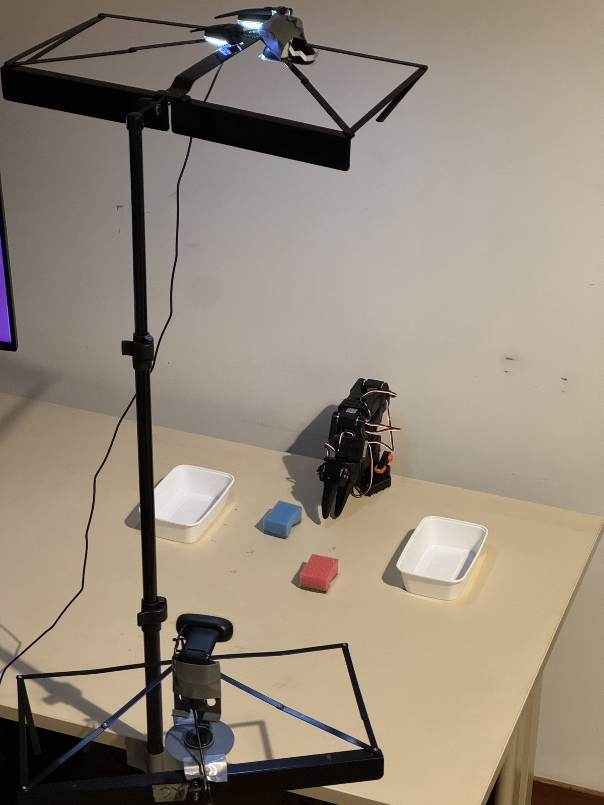

# ACT vs SmolVLA on a LeRobot SO-101 arm

In this experiment I compare a specialist model (ACT, trained from scratch) against a robot-pretrained vision-language-action model (SmolVLA, fine-tuned from `lerobot/smolvla_base`) on a pick-and-place task. I do this on a low-cost SO-101 arm and train on my own machine.

Task: *"Pick up the blue sponge and put it in the white tray."*

The project has two parts. 
- Part 1, below, is this task: one sponge and one sentence.
- [Part 2](#part-2-does-the-arm-do-what-the-sentence-says) has two sponges, two trays and four sentences, and tests whether the arm does what the sentence says.

https://github.com/user-attachments/assets/876e67f6-8099-4559-8161-4afa589ed562

## Results

| Test | ACT | SmolVLA |
|---|---|---|
| 53 careful demos (main test) | 16/18 | 18/18 |
| 18 of those demos | 13/18 | 11/18 |
| Yellow sponge instead of blue | 0/4 | 0/4 |
| 52 rushed demos (my first recording) | 0/18 | 7/18 |

Each model got the same 18 placements of the sponge (9 dots in a 3×3 grid, each straight and turned 45°). In the main test and the 18-demo test the two models were interleaved. 

## What I found

1. **On this task I found no difference between the models.** 16/18 against 18/18 is no significant difference and neither is 13/18 against 11/18 with 18 demos. In the main test both models are at the ceiling, most likely because the task is fairly simple: a pick-and-place task with one object, one sentence, and every test placement was in the demos (in-distribution). This task doesn’t test the language and generalisation the bigger pretrained SmolVLA is built for.
2. **How I recorded the demos mattered more than the model.** My first recording was rushed: I sped up across the demos, grasped quickly, barely opened the gripper over the tray, and drove the arm back home in the same recording. 
I recorded everything again, slower and more carefully, ending each demo at the release. SmolVLA went from 7/18 to 18/18 and ACT from 0/18 to 16/18 (the light also changed between the two recordings). 
On the rushed demos ACT held the sponge in 11 of 18 trials and then froze in mid-air, most likely because the way home in those demos passes the same arm positions as the way to the tray, in the opposite direction.
3. **Fewer demos hurt the grasp first.** Training on a smaller dataset (18 instead of 53 demos), SmolVLA failed to grasp the sponge in 7 trials instead of 0. Both models sometimes stood above the sponge without closing the gripper.
4. **The models learned this blue sponge, not "a sponge".** 
Both models failed all 8 trials with a yellow sponge, on placements where the blue one worked 8 of 8. Writing “yellow” in SmolVLA’s task sentence didn’t help (0/4).
5. **A high success rate hid messy grasps.** Only 13 of 18 grasps were clean for each model in the main test. The soft sponge allowed the gripper to grab it just at the corner or from top in the middle of the sponge.

The details, every table and the full list of limitations are in [APPENDIX.md](APPENDIX.md).

## Setup

- SO-101 follower arm, teleoperated with an SO-101 leader arm.
- Two Logitech C270 webcams (top and side), no wrist camera.
- 9 marked dots 5 cm apart in a 3x3 grid; the sponge starts on a dot, aligned or turned 45°. Lamp light and curtains closed for a reproducible environment.
- ACT (52 M parameters) trained from scratch, run with temporal ensembling; SmolVLA (450 M parameters) fine-tuned from `lerobot/smolvla_base`: the 350 M vision-language backbone stayed frozen, the 100 M action expert was trained, run with real-time chunking (RTC). Both 30,000 steps on one RTX 3060 (12 GB), with [LeRobot](https://github.com/huggingface/lerobot) 0.6.0.

## How I tested

- The protocol ([protocol.md](protocol.md)) was committed before the first training run, with a bet before each test.
- 9 dots × 2 angles = 18 trials per model, in a seeded order, in blocks of 3 alternating between the models.
- One attempt per trial, 30 seconds. Success means the whole sponge in the tray and released.
- I only believe a gap between the models if it is at least twice its margin, about 6 of 18 here.
- Every command I ran is in [commands.md](commands.md). The raw results are in [results/](results/), and
[scripts/analyze.py](scripts/analyze.py) computes the success rates, margins and verdict from them.

<!-- HUB: add links to the datasets and models once they are uploaded. -->

## Limitations

- 18 trials per model can only show large gaps.
- I judged every trial myself and knew which model was running.
- The rushed and careful recordings also differ in light, and the rushed-demo tests weren't interleaved, so those
  comparisons are not clean.
- The cameras moved a few pixels between test days. A control run with the main-test models checked the effect.

More in [APPENDIX.md](APPENDIX.md#limitations).

<!-- ## Reproduce -->

## Next

- Two sponges of different colours, with a sentence that names one: where a VLA should beat ACT. Done in [part 2](#part-2-does-the-arm-do-what-the-sentence-says).
- A rigid object instead of a sponge, to see whether the sponge hid imprecise grasps.
- Retraining with image augmentation, so small camera shifts matter less.

## Part 2: does the arm do what the sentence says?

Part 2 tests two things: language conditioning (does SmolVLA do what the sentence says, also when I reword it?) and data efficiency (how many demos does the model need?).

Two sponges and two trays are always on the table. Only the sentence says which sponge goes in which tray, for example *"Put the red sponge in the left tray"*. There are four sentences. One SmolVLA model reads the sentence. This is compared against four ACT models, where each model is trained on the demos of one sentence and at test time is picked by the sentence.
Both ACT and SmolVLA were trained on the same 96 demos (24 per sentence), with the same number of steps per model.

One sponge lies on one of three dots on the left, the other on one of three dots on the right. That gives 18 placements: 12 are in the demos and 6 were kept out for the test.

### Results

| Test | SmolVLA | 4 × ACT |
|---|---|---|
| Named sponge in the named tray | 34/36 | 36/36 |
| – went for the named sponge | 36/36 | 36/36 |
| – went to the named tray | 34/36 | 36/36 |
| – placements from the demos / new placements | 23/24, 11/12 | 24/24, 12/12 |
| Reworded sentences | 11/16 | --- |
| Trained on 24 / 48 / 96 demos (of 24 trials) | 14/24, 23/24, 23/24 | ---|

A system that ignored the sentence has a 25 % chance of getting it right and would get about 9 of 36.

### What I found

1. **On this task one SmolVLA model did as well as four specialised ACT models.** 
SmolVLA scored 34/36 and the four ACT models 36/36, which is no significant difference. SmolVLA went for the named sponge in all 36 trials; both failed trials were missed grasps. This finding shows the language conditioning SmolVLA is built for: one model reads the sentence and picks the right sponge and tray.
2. **SmolVLA still followed the sentence when I reworded it, but less reliably.** 
With sentences it had never seen it scored 11/16, where guessing would give about 4/16. That is lower than the 34/36 with the original sentences. Three of the four reworded sentences went well (10/12). The fourth sentence, *"Place the red sponge into the tray on the left."*, scored 1/4. Here, three times the arm went for the blue sponge. With the original sentences it went correctly for the named sponge in all 36 trials.
3. **Fine-tuning on fewer demos performed equally well, but leaving out placements dropped performance.** 
Trained on 48 of the 96 demos, which still cover all 12 placements, SmolVLA scored 23/24, the same as with 96. Trained on 24 demos, which cover only 6 placements, it scored 14/24: 11/12 on the placements it had demos of and 3/12 on the six it did not. It still went for the named sponge in 22 of 24 trials, and 9 of its 10 failed trials were grasp failures. So what got worse was the grasp accuracy, not following the sentence.

### Limitations and how to test them

- **Picking accuracy.** 14 of the 18 failed trials in part 2 were grasp failures. A dedicated ego-centric wrist camera could increase the picking accuracy.
- **Language understanding.** One of the four reworded sentences scored 1/4. Testing that sentence against its original wording, taking turns, would show whether the wording is the cause. Testing the reworded sentences on a bigger pretrained model (like GR00T N2 or π0.5) would show whether a larger model follows new wording better.
- **Generalisation.** Trained on 24 demos, SmolVLA scored 3/12 on placements that were not in its training demos. The "new" placements of the main test were only new pairs of known dots. Sponges on dots that are not in the demos at all (out-of-distribution) would test this properly.
- **Task difficulty.** Both ACT and SmolVLA scored very high, so the main test cannot show which one is better. A more complex task with more objects and sentences could.

The details, every table, the corrected rows and all limitations are in [APPENDIX_PART2.md](APPENDIX_PART2.md). Every command I ran is in [commands_part2.md](commands_part2.md), and [scripts/analyze_part2.py](scripts/analyze_part2.py) computes the numbers of the table from [results/](results/).

The protocol and my bets were committed before recording: [protocol_part2.md](protocol_part2.md).

