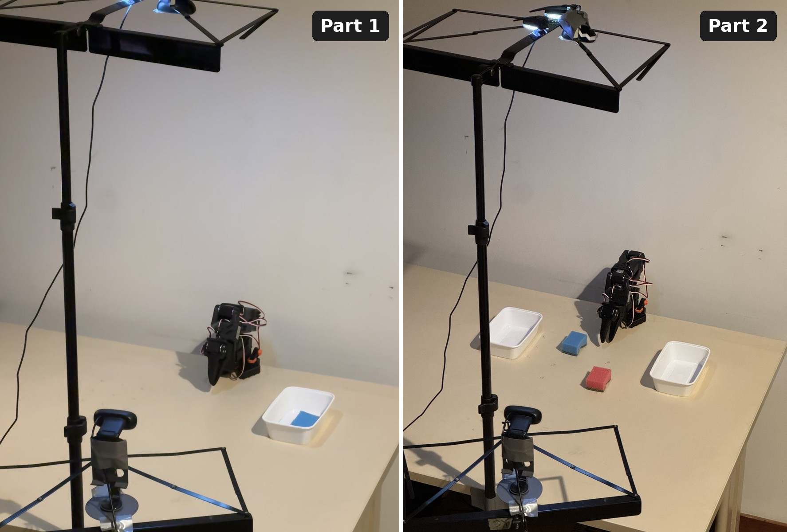

# ACT vs SmolVLA on a LeRobot SO-101 arm

I compare a specialist model (ACT, trained from scratch) against a robot-pretrained vision-language-action model (SmolVLA, fine-tuned from `lerobot/smolvla_base`) on pick-and-place tasks, on a low-cost SO-101 arm, trained on my own machine.

- **[Part 1](#part-1-one-sponge-one-sentence): Experiment with one sponge and one sentence.** Analysing model choice, data quality and data efficiency. 
- **[Part 2](#part-2-does-the-arm-do-what-the-sentence-says): Experiment with two sponges, two trays and four sentences.** Analysing language conditioning and data efficiency.

https://github.com/user-attachments/assets/876e67f6-8099-4559-8161-4afa589ed562

## Part 1: one sponge, one sentence

The task is always the same sentence: *"Pick up the blue sponge and put it in the white tray."*

| Test | ACT | SmolVLA |
|---|---|---|
| 53 careful demos (main test) | 16/18 | 18/18 |
| 18 of those demos | 13/18 | 11/18 |
| Yellow sponge instead of blue | 0/4 | 0/4 |
| 52 rushed demos (my first recording) | 0/18 | 7/18 |

Each model got the same 18 placements of the sponge (9 dots, each straight and turned 45°).

### What I found

1. **On this task both models scored about equally well.** 16/18 against 18/18 is no significant difference and neither is 13/18 against 11/18 with 18 demos.
2. **How I recorded the demos mattered more than the model.** After I recorded my rushed first demos again, slower and more carefully, SmolVLA went from 7/18 to 18/18 and ACT from 0/18 to 16/18 (the light also changed).
3. **Fewer demos hurt the grasp first.** With 18 instead of 53 demos, SmolVLA failed to grasp the sponge in 7 trials instead of 0.
4. **The models learned this blue sponge, not "a sponge".** Both failed all 8 trials with a yellow sponge, on placements where the blue one worked 8 of 8. Writing “yellow” in SmolVLA’s sentence didn’t help (0/4).

### Limitations and how to test them

- **Task difficulty.** This task has limited variation: one object, one sentence and every test placement in the demos. It doesn't test the language and generalisation SmolVLA is built for. A more complex task is tested in [Part 2](#part-2-does-the-arm-do-what-the-sentence-says).
- **Grasp quality.** Only 13 of 18 grasps were clean for each model; the soft sponge let messy grasps succeed. A rigid object would show whether it hid imprecise grasps.

Details: [APPENDIX.md](APPENDIX.md).

## Part 2: does the arm do what the sentence says?

Two sponges and two trays are always on the table. Only the sentence says which sponge goes in which tray, for example *"Put the red sponge in the left tray."* One SmolVLA model reads the sentence. This is compared against four ACT models, each trained on the demos of one sentence and picked by the sentence. Both were trained on the same 96 demos; 6 of the 18 sponge placements were kept out of the demos for the test.

| Test | SmolVLA | 4 × ACT |
|---|---|---|
| Named sponge in the named tray | 34/36 | 36/36 |
| – went for the named sponge | 36/36 | 36/36 |
| – went to the named tray | 34/36 | 36/36 |
| – placements from the demos / new placements | 23/24, 11/12 | 24/24, 12/12 |
| Reworded sentences | 11/16 | --- |
| Trained on 24 / 48 / 96 demos (of 24 trials) | 14/24, 23/24, 23/24 | ---|

A system that ignored the sentence would have a 25% chance and get about 9 of 36.

### What I found

1. **On this task one SmolVLA model did as well as four specialised ACT models.** 34/36 against 36/36 is no significant difference. SmolVLA went for the named sponge in all 36 trials; both failed trials were missed grasps. This finding shows the language conditioning SmolVLA is built for: one model reads the sentence and picks the right sponge and tray.
2. **SmolVLA still followed the sentence when I reworded it, but less reliably.** With sentences it had never seen it scored 11/16, where guessing would give about 4/16. Three of the four reworded sentences went well (10/12). The fourth, *"Place the red sponge into the tray on the left."*, scored 1/4: twice the arm went for the blue sponge, and once the grasp of the red sponge failed.
3. **Fine-tuning on fewer demos performed equally well, but leaving out placements dropped performance.** With 48 of the 96 demos, which still cover all 12 placements, SmolVLA scored 23/24, the same as with 96. With 24 demos, which cover only 6 placements, it scored 14/24: 11/12 on the placements it had demos of and 3/12 on the six it did not. What got worse was the grasp, not following the sentence.

### Limitations and how to test them

- **Picking accuracy.** 15 of the 18 failed trials in part 2 were grasp failures. A wrist camera could increase the picking accuracy.
- **Language understanding.** One of the four reworded sentences scored 1/4. Testing it against its original wording, and on a bigger pretrained model (like GR00T N2 or π0.5), would show whether the wording or the model is the cause.
- **Generalisation.** With 24 demos, SmolVLA scored 3/12 on placements outside its demos (out-of-distribution: new pairs of dots it had seen). Sponges on dots that are in no demo at all would test this further.
- **Task difficulty.** Both systems scored very high, so the main test cannot show which one is better. A more complex task could.

Details: [APPENDIX_PART2.md](APPENDIX_PART2.md).

## Setup and method

- SO-101 follower arm, teleoperated with a leader arm. Two Logitech C270 webcams (top and side), no wrist camera.
- ACT has 52 M parameters, SmolVLA 450 M (100 M trained). Same number of training steps for both, on one RTX 3060 (12 GB), with [LeRobot](https://github.com/huggingface/lerobot) 0.6.0.
- Both protocols ([protocol.md](protocol.md), [protocol_part2.md](protocol_part2.md)) were committed before the models were trained, with a bet before each test.
- In the main tests the models take turns in blocks of 3, in a seeded order, one attempt of 30 seconds per trial.
- I only believe a gap if it is at least twice its margin: about 6 of 18 in part 1 and 9 of 36 in part 2.
- Commands: [commands.md](commands.md), [commands_part2.md](commands_part2.md). Raw results: [results/](results/). Analysis: [scripts/analyze.py](scripts/analyze.py), [scripts/analyze_part2.py](scripts/analyze_part2.py).

<!-- HUB: add links to the datasets and models once they are uploaded. -->
